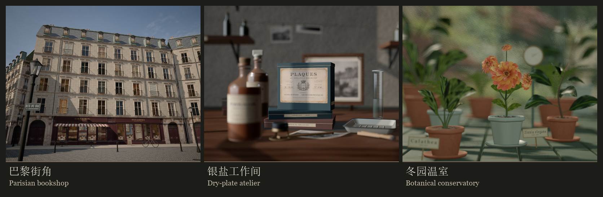
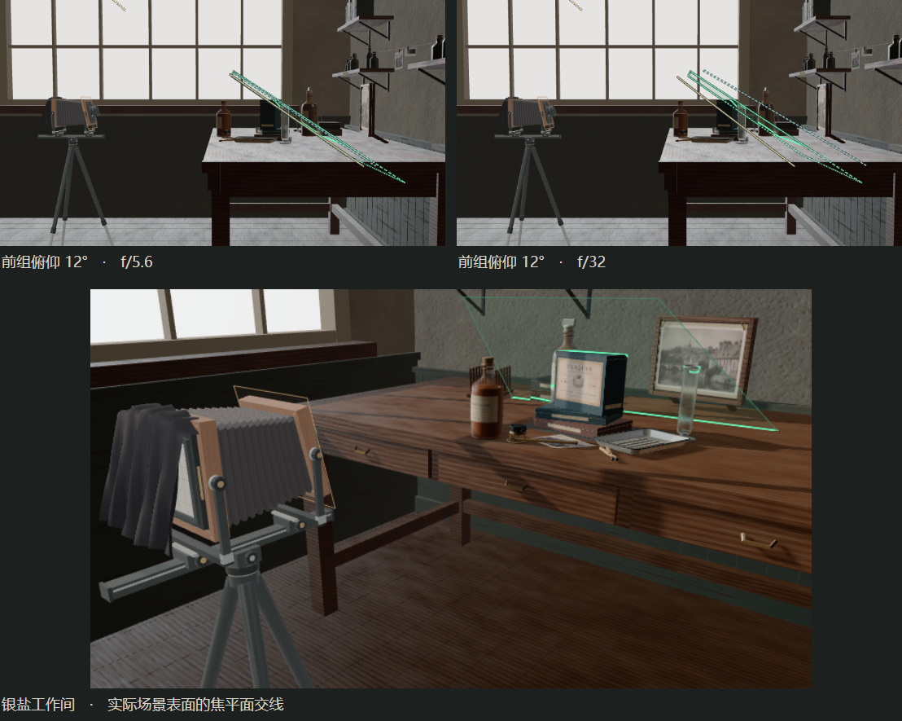

# 暗箱 · Obscura View Camera

一台在浏览器中操作的 4×5 技术相机。在同一个摄影现场，一边看毛玻璃上的影像，一边移动镜头板、片夹与皮腔，观察焦平面怎样切过桌上的药瓶、温室叶脉或街角的立面。

A working 4×5 view camera in your browser. Focus on a bottle label near the back of a silver-gelatin workshop, then tilt the lens and watch the plane of focus cut across the table. The scene in the ground glass is rendered through the camera you are adjusting.

[在线取景 / Open the workbench](https://alicemarskov.github.io/obscura-view-camera/) · [离线单文件 / Download HTML](https://github.com/AliceMarskov/obscura-view-camera/releases/download/v0.2.0/Obscura-4x5-v0.2.0.html) · [版本与校验值 / Release & checksum](https://github.com/AliceMarskov/obscura-view-camera/releases/tag/v0.2.0) · [English guide](#english-guide)



## 中文指南

**第一次试拍。** 选择「银盐工作间」，保留 150 mm 镜头。点「正像」可将毛玻璃翻正。把干版盒放大到 2×，钉住测点 A，再拖到前面的药瓶纸标。打开「峰值」，选择「前组 → 俯仰」，一点点调整。再到「皮腔 / 整机」微调皮腔，同时查看两处文字。比较不同光圈时，关闭「全开对焦」。

**检查光路。** 点「机位」并选择「光路侧视」，打开「光学平面」和「景深」。实物上的绿线标出绝对合焦的位置。把光圈从 f/5.6 收到 f/32，近、远两界会分开，允许合焦的区域随之扩大。虚线及交点只在落入可见范围时显示。



| 想观察的现象 | 可以操作的部位 |
| --- | --- |
| 近物与远物能否同时清晰 | 前后组独立俯仰与摆动、皮腔对焦、光圈。支持拖动滚轮、粗精切换、Shift 精调、步进和直接输入 |
| 建筑竖线会聚与重新构图 | 「巴黎 · 奥斯曼街角」中调平后背，再升高前组。移动观察机位可环绕机构 |
| 离焦与纹理精度 | 选择 90、150 或 210 mm 镜头，在 2×/4× 下拖动放大镜。用「清晰度参照」观察同一机位的镜心光线图像 |
| 旋转后背与取景范围 | 「横幅 / 竖幅」切换 120 × 96 mm 与 96 × 120 mm。厘米刻线、6×9 角标与中心十字随放大镜移动 |
| 输出一张照片 | 「印样」导出带拍摄参数的完整正像 PNG。「接片」记录两次有重叠的后组横移取景并拼合 |

**离线使用。** 从发布页下载 `Obscura-4x5-v0.2.0.html`，在支持 WebGL 2 的桌面浏览器中打开。场景、纹理、光路校准台和许可信息都在这一份文件里。手机可直接使用上方在线版。应用界面采用简体中文，保留物理刻度和镜头单位。[操作细节、光学推导与实验](docs/optics.zh-CN.md)

## English guide

**Try a two-point focus.** Choose 银盐工作间 (silver-gelatin workshop) and the 150 mm lens. Start with the plate carton. Press 正像 for an upright image. Magnify the carton label to 2×, pin point A with 钉住 A, then drag the loupe to the nearer bottle label. Enable 峰值 (focus peaking). Adjust 前组 → 俯仰 (front tilt) and 皮腔 (bellows extension) alternately. Both views follow the same focus and aperture settings. Turn off 全开对焦 (focus wide open) to preview your working aperture.

**Read the construction.** Switch to 机位 (observer), select 光路侧视 (side view) or 俯视 (top view) and turn on 景深 (depth of field). The near solid line and far dashed line trace the 0.10 mm blur criterion through the centre of the film in that section. Stop down the lens to widen the acceptable region. 光学平面 draws the focus plane and marks its intersection with visible surfaces. The hinge line lies in the front focal plane. The Scheimpflug line is common to the extended lens, film and subject focus planes.

| Control | What it changes |
| --- | --- |
| 前组 / 后组 — Front / rear standard | Independent rise/fall, shift, tilt and swing |
| 皮腔 / 整机 — Bellows / body | Extension changes focus. Pitch/yaw rotates the camera on its support. Orbiting the observer changes the external view |
| 全开对焦 / 正像 / 网格 | Open the aperture for focusing, rotate the inverted image for viewing, or overlay centimetre rulings |
| 1× / 2× / 4× | Full frame or a movable loupe. 清晰度参照 uses centre-pupil rendering to check the available scene detail |
| 横幅 / 竖幅 · 印样 · 接片 | Rotate the film holder, save a full-frame contact proof, or stitch two overlapping rear-shift exposures |

**Scenes.** Photograph a constructed Parisian bookshop with converging window columns, a silver-gelatin workshop with near and far labels, or a conservatory with leaves, flowers and an instrument dial. The three teaching lenses have nominal focal lengths of 90, 150 and 210 mm. Desktop landscape and portrait phone layouts share the same controls. The interface is in Simplified Chinese. The downloadable HTML runs offline in a WebGL 2 browser.

## 光学模型 / Optical model

接触印样以实际孔径重新采样，成像长边至少为 1200 像素。缩小取景窗或切到手机时，下载的照片仍可保留远处的细部。磨砂纹、刻线、焦点辅助和 A 点小窗只出现在取景屏上。

Contact proofs use a full-gate exposure with a minimum long edge of 1200 pixels. A narrow phone preview can still produce a detailed print. Grain on the ground glass, etched lines, peaking and the auxiliary loupe belong to the viewing screen.

长度采用毫米。薄透镜的镜心为 L，片心为 B，n、m 分别为镜头板和片面朝后的单位法向。设置 d = m·(B − L)，则物方绝对合焦面满足 **(f m − d n)·(P − L) = f d**。在两组平行、皮腔 174 mm、焦距 150 mm 时，物距为 1087.5 mm，可在光路校准台复算。

The millimetre-based kernel uses an ideal paraxial thin lens. With parallel standards and image distance v, it recovers **1/f = 1/u + 1/v**. With tilted standards the focus plane obeys the equation above. Photographic rendering integrates radiance over the pupil. Stopped-down highlights use an equal-area seven-blade aperture. The teaching depth contours use a nominal circular pupil and the largest diameter across twelve opposed rim pairs. The model includes relative oblique illumination, bellows extension and a nominal image circle. Lens aberrations, diffraction, mechanical collisions and measured film sensitometry are outside its scope. [Optics and validation notes](docs/optics.zh-CN.md) · [Merklinger, *Principles of View Camera Focus*](https://lensnotes.com/articles/principles-of-view-camera-focus/)

## 本地开发 / Development

使用 Node.js 24。Windows PowerShell 也可用 `npm.cmd`。Run the following from the repository root with Node.js 24.

```sh
npm ci
npm test
npm run dev
```

打开本地实验台或校准台。Open the local workbench or the lens calibration screen. [Workbench](http://127.0.0.1:5173/) · [Calibration](http://127.0.0.1:5173/calibration.html)

```sh
npm run build
npm run build:offline
node verification/release-file.mjs
```

`npm run build` 生成可静态托管的 `dist/`。离线构建生成 `dist/暗箱-大画幅取景台.html`。发布检查核对嵌入素材、许可及 18 MB 文件预算。The web build produces a static directory. The offline build also embeds all runtime imagery and scripts in one HTML file. To reproduce the browser checks locally, install Microsoft Edge and run the following from the repository root.

```sh
node verification/focus-contour.mjs
node verification/depth-guides.mjs
node verification/standalone.mjs "dist/暗箱-大画幅取景台.html"
```

| 代码位置 / Source | 职责 / Responsibility |
| --- | --- |
| `src/optics.ts`, `src/depth-geometry.ts`, `src/focus-slice.ts` | 独立光学模型、景深与裁切 / projection, pupil rays, depth bounds and clipping |
| `src/ground-glass.ts`, `src/focus-feedback.ts` | 毛玻璃与放大镜 / sensor sampling, pupil integration, loupe and peaking |
| `src/scenes/`, `src/equipment.ts`, `src/bench.ts` | 实景、镜头与机位 / scene geometry, equipment, camera mechanism and observer |
| `test/`, `verification/` | 数学回归与实机浏览器验收 / mathematical regressions and browser checks |

## 许可与来源 / License and credits

原创程序代码采用 MIT 许可。项目制作的图像、外部天空、依赖库分别列有来源。Original software is MIT licensed. The sky is a CC0 photograph from Poly Haven. Scene illustrations and other dependencies have separate credits. [MIT license](LICENSE) · [Scene assets and attribution](ASSETS.md) · [更新记录 / Changelog](CHANGELOG.md)
